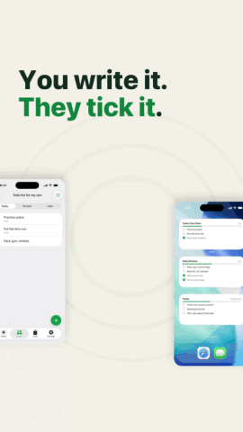
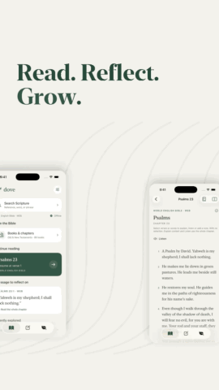

<div align="center">


### ⭐ Stars are appreciated! ⭐

**Product launch videos with real app assets, directed motion and original music**

**Hype videos for your product, drawn in code on your Mac.**
A Claude Code plugin that reads your app, website or project, plans a beat-synced film you approve, composes original music and renders an editable MP4.

Free · open source · macOS only · no extra setup for music-only films

<br />

[](LICENSE)
[](https://github.com/suntay44/motionable/releases)


<br />
</div>

**motionable** is a free, open-source [Claude Code](https://claude.com/claude-code) plugin that turns your app's repo, your website or a few screenshots into a **15–30 second hype video**: a launch video, an app promo or a social ad. It plans the film from your product's personality, composes original music, audits text timing and layout, and renders the MP4 with Swift on your Mac. Visual quality and sound still need human review. You don't need After Effects, Remotion, ffmpeg or a subscription.

## Contents

- [Demo](#demo)
- [Energetic launch series](#energetic-launch-series)
- [Install](#install)
- [How to use it](#how-to-use-it)
- [Scenarios](#scenarios)
- [Example runs](#example-runs)
- [What you get](#what-you-get)
- [Built on research](#built-on-research)
- [FAQ](#faq)
- [Requirements](#requirements)
- [Codex (experimental)](#codex-experimental)
- [Contributing](#contributing)
- [Licence](#licence)

## Demo

### Owly — original visual direction


**[Watch with sound](docs/demos/owly-original.mp4)** · 9:16 · 30 seconds · original code-composed score at 120 BPM

One card carries the story from a list to a widget, family circles, a capacity bar and the app icon. Consistent headlines, sequential product explanation and musical payoffs keep the story connected. See [the five principles](docs/motion-craft.md#story-led-motion-five-principles) and [the original example source](examples/owly).

This authored film is the original reference from which Motionable grew. It predates the modern audit, and its release wording reflects its original production date. New generated films still need visual and listening review.

### More product examples

Three films for three real apps, each made from its repo with `/motionable:project`. Each has its own format, music and look:

<table>
<tr>
<td align="center" width="25%"></td>
<td align="center" width="45%"></td>
<td align="center" width="30%"></td>
</tr>
<tr>
<td align="center"><b>Ponda the Chef</b><br />9:16 · 30 s · Reels, TikTok, Shorts<br />punchy pop, 122 BPM</td>
<td align="center"><b>Owly the Scribe</b><br />16:9 · 25 s · YouTube, a website<br />real screen recordings, piano and kalimba</td>
<td align="center"><b>Bonnie</b><br />1:1 · 15 s · feeds<br />a 3/4 music-box lullaby, 72 BPM</td>
</tr>
</table>

**With sound:** [Ponda the Chef](https://github.com/suntay44/motionable/releases/latest/download/ponda-the-chef.mp4) · [Owly the Scribe](https://github.com/suntay44/motionable/releases/latest/download/owly-wide.mp4) · [Bonnie](https://github.com/suntay44/motionable/releases/latest/download/bonnie.mp4). Each film's plan and code are in [examples/](examples).

## Energetic launch series

Three newer vertical films use real product evidence with layered screens, focused UI, drawn accents and musical payoffs. Each includes independently timed 30-second and 15-second cuts. The source uses Motionable’s native Swift renderer; the visual research includes HyperFrames examples.

<table><tr>
<td align="center"><br><b>Owly</b><br>Real recordings · 120 BPM</td>
<td align="center"><br><b>Ponda the Chef</b><br>Recipe maths · 128 BPM</td>
<td align="center"><br><b>Dove</b><br>Study and discovery · 112 BPM</td>
</tr></table>

Plans, source, asset provenance and review limits: [Owly](examples/owly-launch), [Ponda](examples/ponda-launch), [Dove](examples/dove-launch). GIFs have no audio; render the full MP4s using each example’s README. Checks and export evidence are in [the validation report](docs/launch-series-validation.md). Official Apple badge files are excluded; an explicitly invoked download helper fetches them from Apple. Without the badge, these examples render text availability.

## Install

In Claude Code:

```
/plugin marketplace add suntay44/motionable
/plugin install motionable@motionable
```

For Claude desktop, follow the current [plugin installation instructions](https://code.claude.com/docs/en/discover-plugins#install-a-plugin); interface and custom-marketplace availability can vary. The CLI commands above are the repository’s documented installation route.

To update later, run `claude plugin marketplace update motionable`, then `claude plugin update motionable@motionable`.

## How to use it

**1. Make one folder for all your videos** (your studio) and open Claude Code there:

```bash
mkdir ~/HypeVideos && cd ~/HypeVideos && claude
```

**2. Run one command**, depending on what you have:

| You have | Run |
|---|---|
| The app's code or files on your Mac | `/motionable:project ~/Projects/my-app` |
| A website or landing page | `/motionable:website https://my-app.com` |
| Just an idea and some screenshots | `/motionable:scratch` |

**3. Answer a few questions:** where people will watch it, what they should see first, and whether it's out yet.

**4. Approve the plan.** You see a 4-line treatment (feel, sound, look, signature moment) and the beat grid. You also choose whether Claude should draw illustrations for the film.

**5. Get the film.** Claude builds a first draft and reviews it itself, then fixes it in a second draft. It checks:
- text timing against a reading-time heuristic;
- that nothing sits under the apps' buttons;
- that the first frame reads;
- that nothing flashes too fast;
- measured soundtrack similarity to your other films (a listening aid, not a quality verdict).

Then it renders the MP4 and asks 3–4 short questions about pacing, sound, hook and ending, and revises once per round of answers. It doesn't loop forever.

## Scenarios

| Your situation | What to do | What you get |
|---|---|---|
| An iOS app launching soon | `/motionable:project ~/Projects/my-app` | A 30 s 9:16 teaser that says "Coming soon" (never "Download" before it's live), plus a 15 s cut |
| A SaaS with a landing page | `/motionable:website https://my-app.com` | A 16:9 hero video for the site, then a 9:16 version for socials |
| An idea and a few Figma screens | `/motionable:scratch` | A short teaser from your words and pictures |
| A new feature to announce | `/motionable:project …`, then pick the feature to show first | An update video built around that one feature |
| A live app running ads | After the first film: "make hook variants" | The same film with each of the plan's three hooks, for an A/B test |
| Posting with a trending sound | `run.sh <film> video effects` | The sound effects only, so the platform's sound goes on top |
| An app with no screenshots | `/motionable:project …` with the app in the Simulator | Claude captures each screen while you open it |
| A screen recording of your best feature | Drop it in with any command | The film plays the real app working: zoomed, sped up and freeze-framed |
| Optional voiceover | Choose during the initial questions | Local Kokoro after one-time setup, or your own recording; preview before approval |

## Example runs

**An iOS app repo**

```
/motionable:project ~/Projects/PandaChef
```

1. Reads the README, App Store metadata, design tokens and screenshots, without writing to the folder.
2. Asks where people will watch it, what to show first, and whether it's out yet.
3. Plan mode reads its personality: warm, capable, a little cheeky. It directs a punchy kitchen-pop film from that.
4. Shows the treatment and beat grid. You approve.
5. Builds draft 1, reviews it, then fixes it in draft 2, then asks you 3 questions.
6. Delivers `~/HypeVideos/ponda-the-chef/out/ponda-the-chef-hype.mp4`.

**A SaaS landing page**

```
/motionable:website https://acme.app
```

1. Pulls the name, pitch, features, colours, logo, screenshots and store links.
2. If the site has too few product screenshots, it asks you to drag in 2–4 more.
3. Plans, gets your approval, and renders the MP4.

**A brand-new idea**

```
/motionable:scratch Acme Notes
```

1. Asks a few quick questions, then asks you to drag in a logo and 3+ screenshots.
2. Plans, gets your approval, and renders the MP4.

**Later, in the same folder:**

```
make a 15-second cut of ponda-the-chef
make owly-launch square for Instagram
the hook is too slow; open on the widget instead
```

## What you get

```
~/HypeVideos/ponda-the-chef/
├── DIRECTION.md  the plan: evidence, personality, every choice with its reason
├── SCRIPT.md     the beat grid: every moment, its words and its sound
├── scenes/       the film as Swift code, with its own copy of the engine
├── assets/       logo and screenshots (copied, never moved) · drawn/ illustrations
└── out/          ponda-the-chef-hype.mp4 · music.m4a · beats.json
```

- **Your real product:** your screenshots, colours and logo, and no invented features. Claims to double-check are listed for you.
- **The app working:** give it a screen recording (from the Simulator, QuickTime or your phone) and it plays the real app: speeding through waits, zooming in where things happen, freezing on results, with a finger on every tap. No recording? It acts out the app on screenshots: typing with a caret, taps, screens changing.
- **Directed, not templated:** no style presets. Plan mode sets about 16 dials from your product's evidence (tempo, key, drums, instruments, type, framing, transitions…). A fingerprint and sound comparison help identify accidental reuse while preserving deliberate visual continuity.
- **Type with character:** a film can mix faces, weights, italics, sizes and colours word by word, like a serif italic for the feeling phrase, bigger numbers, or a key word in the brand colour. Each accent has a job, and every line's contrast is measured.
- **Motion that explains:** stable headline hierarchy, a visual thread where useful, sequential information and musical anchors. The engine supplies entrances, paths and transformations; the direction chooses what helps the viewer understand the product.
- **Choreographed motion:** adjustable easing and finite springs, paths with shared velocities, persistent elements between layouts, and optional temporal blur for selected artwork. Reading pauses and stillness are part of the plan.
- **Moving-sequence review:** `motion` renders a draft and dense sequences around actions and joins. Automated checks measure specific faults; professional quality still needs visual playback review.
- **Original music:** composed in code for each film, in any tempo, key, groove or meter (even a 3/4 lullaby), and synced to every cut. No stock music is bundled; supplied tracks, brand assets and optional voice models have their own licences.
- **Readability audits:** checks estimate reading time, contrast, safe-zone placement and crop issues. The agent fixes reported faults and inspects playback; these heuristics do not guarantee comfortable reading or detect every visual problem.
- **Storyboarded, then audited:** settle the composition before animating. Layout checks flag text overlap, cut-off text, crop edges, coverage, empty stretches and uneven margins; visual review remains necessary.
- **Music with phases:** when the story wants it, the groove can drop to half-time under the problem and snap back at the reveal, change tempo through a tape stop or a beat of silence, or slow into the ending. The picture follows the same beat.
- **Store-safe:** Apple's badge is never animated, and Google Play is shown only if you're on it.
- **Local rendering:** render time depends on the Mac and effects. Recent 30-second 1080p/60 fps films took roughly one to four minutes after compilation; complex layers can take longer.

## Built on research

motionable's structure follows what the platforms, ad data and practitioners agree on ([RESEARCH.md](RESEARCH.md)):

- **The message lands in the first 3 seconds.** The hook reads in frame 1.
- **One message and 2–3 benefits**, each shown on real UI, big enough to read.
- **The text carries the meaning, and the sound adds to it.** Every line gets its reading time.
- **The brand appears early, woven in**, never as a logo slate. The end card has a true call to action.
- **Purposeful craft:** clear hierarchy, connected visual handoffs, measured settling, varied shot lengths and original sound, with no strobing (at most three flashes a second).

## FAQ

**What is motionable?**
A Claude Code plugin that makes motion-graphics hype videos for apps and products. It's free and open source, and it runs on macOS.

**Is it free?**
Yes. The plugin is MIT-licensed, with no render credits and no subscriptions. The planning runs in Claude Code on your own Claude plan.

**Does it work on Windows or Linux?**
No. It renders with Apple's built-in frameworks (Core Graphics, Core Text, AVFoundation) through Swift, so it needs a Mac.

**Do I need After Effects, Remotion or ffmpeg?**
No. The Swift engine draws the film and composes the music. Optional generated narration uses a separately downloaded local Kokoro helper.

**Can I use the video as an App Store preview?**
No. App Store previews must be footage captured from the app itself (App Review Guideline 2.3.4). Use motionable videos for social posts, ads, websites and launch posts. To make a preview, record the app instead, for example with `xcrun simctl io booted recordVideo`.

**Is the music copyright-free?**
The bundled score is synthesized from code rather than a stock recording. This is not a copyright guarantee. You remain responsible for rights to supplied recordings, tracks and brand assets; optional voice components have separate licences. See [licence details](#licence).

**Will my videos all look the same?**
The workflow directs each film from its product’s evidence and supports deliberate series continuity. Results vary with the model and direction; the examples demonstrate possibilities, not guaranteed output quality.

**Can I use my brand's fonts and colours?**
Yes. Drop the font files into the film's `assets/fonts/` (if their licence allows it), or let it pick a matching macOS face. Colours come from your logo, screenshots or site, and accents are checked for contrast.

**Does it change my project?**
No. `/motionable:project` only reads the folder you point it at, and the film goes into your studio folder.

**Can I edit the result?**
Yes. Tell Claude what to change, or edit `SCRIPT.md`, `DIRECTION.md` or `scenes/Film.swift` yourself. Render time varies with hardware and effects.

**Which formats and lengths?**
9:16, 16:9, 1:1 or any custom size, usually 15–30 s (up to 60 s).

## Requirements

- macOS 15 or later
- The Xcode command line tools (free): `xcode-select --install`
- Claude Code (the CLI or the desktop app)
- About 1 GB of free disk space while rendering

## Codex (experimental)

The skills are plain Markdown, so Codex can load them, but motionable is tested in Claude Code:

```bash
git clone https://github.com/suntay44/motionable ~/.motionable
mkdir -p ~/.agents/skills
for s in scratch website project make; do ln -s ~/.motionable/skills/$s ~/.agents/skills/motionable-$s; done
```

## Contributing

The macOS test workflow runs on pushes to `main` and pull requests. It uses no voice-model download. To run the same checks locally, use the scripts below.

- [PLAN.md](PLAN.md): plan mode.
- [ENGINE.md](ENGINE.md): the ingredients.
- [rules.md](rules.md): what every film follows.
- [checklist.md](checklist.md): the self-critique.
- [RESEARCH.md](RESEARCH.md): the evidence.
- [docs/public-release-review.md](docs/public-release-review.md): review scope, verification and remaining limits.
- `bash scripts/test-craft.sh`: renders the Owly craft benchmark, checks readability/layout, and decodes both video exports to verify dimensions, frame counts, timing, audio presence and the final hold.
- `bash scripts/test.sh`: checks scaffold escaping and preservation, render failure recovery, choreography, narration, engine and helper regressions, renders every element, entrance, look and transition once, verifies the layout audit, then checks every example film.
- `bash scripts/regression.sh`: checks playback timing, sparse and rotated recordings, tempo maps, font caching and cut entrances with temporary fixtures.
- `bash scripts/inspect.sh <screenshot> find <colour>`: measures UI for exact redraws.

## Licence

MIT for Motionable’s original code and docs; third-party voice helpers retain their upstream notices. The rendered demo videos and GIFs are showcase media, not reusable product assets. The app screenshots, icons and mascots in `examples/*/assets/` belong to their apps and aren't covered by MIT ([details](examples/README.md)). Standalone Apple badge artwork is excluded; motionable asks before downloading it from Apple. The original demo includes the badge as part of the finished promotional video. Optional voice dependency notices are in [tools/voice/NOTICE.md](tools/voice/NOTICE.md).

## Optional local voiceover

The initial questions offer a generated voice, your own recording, or music/effects only.
Generated speech uses Kokoro `af_heart` locally after optional setup (about 153 MB of downloads;
Apple Silicon, US English; Python 3 required for the optional voice commands). No paid account or transcription model. Supplied recordings do not need
Kokoro. Approved audio stays with the film and renders offline. The first voice is fixed; preview it
before approving a full take. See [voiceover workflow](docs/voiceover.md) for setup, script, import,
approval, captions and revisions. Cloud voices and automatic transcription are not integrated.
